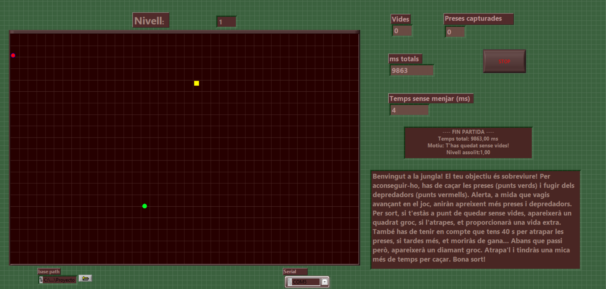
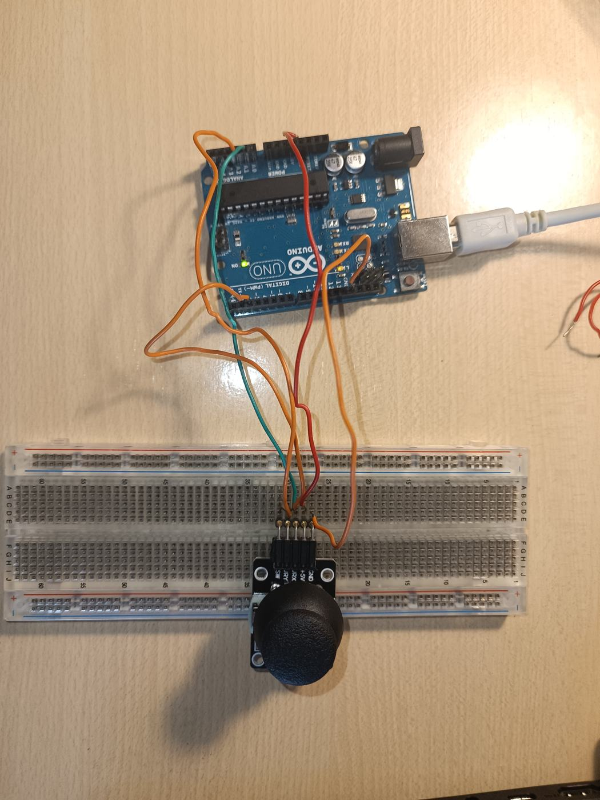
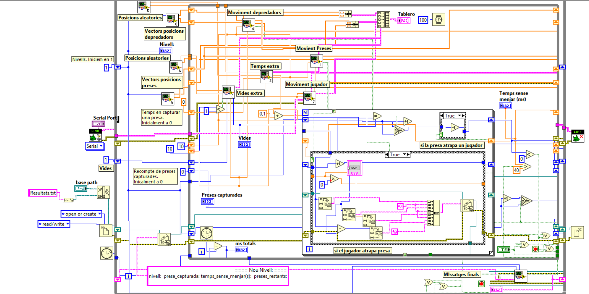

# Jungle Survival Game — LabVIEW & Arduino

**Academic team project · December 2025 · LabVIEW · Arduino · Analog joystick · Data acquisition**

A two-dimensional survival game developed in **LabVIEW** and controlled by an **analog joystick connected to Arduino**. It combines real-world input acquisition, coordinate-based movement, game-state control and text logging.

**Authors:** Gurpinder Singh Kaur and Paula Ponsetí Tudurí.

**Status:** Completed university assignment. The original VIs have not been independently re-run on a new system.

## Technical implementation

- **Analog acquisition:** a joystick connected to Arduino supplies X/Y readings; values are offset and normalized into a movement range around −1 to +1.
- **Game mechanics:** prey flee, predators chase the player when nearby, and higher levels add more entities.
- **Control logic:** loops, Case structures, shift registers, arrays, SubVIs and an XY Graph.
- **State and timing:** collisions, lives, prey-capture deadlines, level progression and temporary power-ups.
- **Data logging:** text-based records of captures, elapsed time, levels and end-of-game conditions.

## Wiring

| Joystick contact | Arduino pin | Function |
| --- | --- | --- |
| GND | GND | Ground |
| +5V | 5V | Power |
| VRX | A1 | Horizontal analog input |
| VRY | A2 | Vertical analog input |
| SW | Digital pin 2 | Joystick button |

## Files

- `labview/JocAcabatEntregableAmbSubVis.vi` — submitted main VI using SubVIs.
- `labview/JocAcabatSenseSubvis.vi` — alternative implementation.
- `labview/` — 12 unmodified original VI files.
- `docs/Informe_Projecte.pdf` — original project report (Catalan).
- `assets/` — front panel, block diagram and Arduino wiring photograph.

## Opening the project

1. Open `labview/JocAcabatEntregableAmbSubVis.vi` in a compatible NI LabVIEW installation.
2. Keep all SubVIs in the same folder to preserve references.
3. Connect Arduino and the joystick according to the wiring above.
4. Select the relevant serial port and a writable output folder on the front panel.
5. Consult the original report for system logic and the hardware setup.

**Compatibility limitation:** The submitted project did not include an Arduino firmware sketch, the exact LabVIEW/toolkit versions or a complete install procedure. Serial/Arduino dependencies must be identified before the project can be reproduced on a different system. Hardware execution was not re-verified for this public documentation.

## Block diagram

## Engineering problems solved

- The joystick readings are normalized before controlling player coordinates; the motion is constrained to the game board.
- Predator and prey movement uses distance and direction vectors.
- Captured objects are moved outside the active board rather than deleted from arrays during iteration, avoiding index issues.
- Shift registers and loop data flow were adjusted to resolve interference between logging and joystick interaction.
- The game timer relies partly on estimated loop timing rather than a hardware real-time clock.

## Scope and credits

Created collaboratively by **Gurpinder Singh Kaur** and **Paula Ponsetí Tudurí** as a university project. The original VIs and report are provided for portfolio and educational review; they are not presented as a production system. No third-party NI LabVIEW software is redistributed and no open-source license is granted by this repository.
